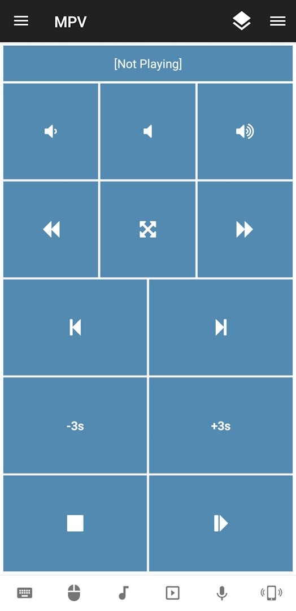

# MPV Remote for Unified Remote

Control mpv with the [Unified Remote](https://www.unifiedremote.com) app. This remote sends keyboard shortcuts
to the mpv window; it does not launch the player or open media files.

<kbd></kbd>

## Requirements

- Unified Remote Server installed and running on your computer.
- mpv installed. The remote checks `/usr/bin/mpv` and `/bin/mpv` on Linux, as
  well as common paths on Windows.
- The remote control brings the `mpv.exe` window to the foreground when a command is sent.

## Installation

Place the project folder in the Unified Remote remotes directory, then select
**MPV** in the app. 
The directory location depends on your Unified Remote
installation; see the [app documentation](https://www.unifiedremote.com/tutorials/how-to-install-a-custom-remote) to find the custom remotes folder.

| OS | Location |
| --- | --- |
| Windows | C:\ProgramData\Unified Remote\Remotes\Custom |
| Mac | ~/Library/Application Support/Unified Remote/Remotes/Custom |
| Linux | ~/opt/urserver/remotes/custom |

## Controls

| Action | Command sent to mpv |
| --- | --- |
| Play/Pause | `p` |
| Stop | `q` (closes mpv) |
| Decrease / increase volume | `9` / `0` |
| Mute | `m` |
| Previous / next playlist item | `<` / `>` |
| Rewind / fast-forward | Left / right arrow |
| Decrease / increase playback speed | `[` / `]` |
| Toggle fullscreen | `f` |

## Customizing key bindings

If your `input.conf` uses different keys, you can edit the key passed to the matching
action in `remote.lua`. 

For example, if your `input.conf` contains
`SPACE cycle pause`, change `kb.stroke("p")` in `actions.play_pause` to
`kb.stroke("space")`. 

Use the key on the left side of the `input.conf` line;
the command on the right side does not go in `remote.lua`.

Use `kb.stroke("key")` for named keys and keys with modifiers, and
`kb.text("character")` for literal characters such as `<`, `>`, `[` and `]`.

Apply the same change to the matching action for any other remapped control.

## Troubleshooting

- If a command does not work, check whether mpv's `input.conf` remaps the
  corresponding shortcut.
